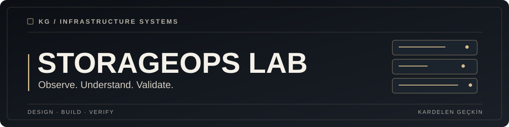

**A working FastAPI and React lab for exploring storage performance, capacity and alerting through synthetic data.**

[Getting started](#getting-started) · [Architecture](docs/ARCHITECTURE.md) · [Validation](#validation)

## Overview

StorageOps Lab simulates a small storage estate and exposes its metrics through a read-only API and an interactive dashboard. It is an infrastructure architecture learning project. **No real devices, customer data, vendor API credentials or employer information are used.**

## What it includes

* Three fictional storage arrays with changing capacity, IOPS, throughput and latency.
* Read-only FastAPI endpoints, interactive API documentation and a Prometheus-compatible metrics endpoint.
* React dashboard with array selection, metric toggles, time-window filters, alerts and automatic refresh.
* Capacity and latency threshold alerts, backed by domain and API tests.
* Local Docker Compose configuration for both services.

## Getting started

**Requirements:** Python 3.11+, Node.js 20+ with npm, or Docker Compose.

### Backend

~~~bash
cd backend
python -m venv .venv
# Activate the virtual environment for your OS
python -m pip install -r requirements.txt
uvicorn storageops.api:app --reload --host 127.0.0.1 --port 8000
~~~

Open the API documentation at http://127.0.0.1:8000/docs and the health endpoint at http://127.0.0.1:8000/health.

### React frontend

In a second terminal, from the repository root:

~~~bash
cd frontend
npm install
npm run dev
~~~

Open http://127.0.0.1:5173. The dashboard uses local, read-only API requests.

### Docker Compose

~~~bash
docker compose up --build
~~~

Open http://127.0.0.1:5173. The compose configuration is intended for local simulation only.

## Repository structure

~~~text
storageops-lab/
├── backend/
│   ├── storageops/         # API and simulator
│   ├── tests/              # Unit and HTTP contract tests
│   ├── requirements.txt
│   └── Dockerfile
├── frontend/
│   ├── src/                # React dashboard and styling
│   ├── package.json
│   └── Dockerfile
├── docs/
│   ├── assets/cover.svg    # Shared portfolio theme
│   ├── ARCHITECTURE.md
│   └── SECURITY.md
├── docker-compose.yml
└── README.md
~~~

## Validation

~~~bash
cd backend
python -m pip install -r requirements-dev.txt
python -m pytest -q tests
~~~

The 14 backend tests passed in the preparation environment. GitHub Actions will run checks against the branch. Frontend package installation and Docker builds still need independent validation with npm registry access.

## Architecture & decisions

Read the [architecture notes](docs/ARCHITECTURE.md) for component boundaries, API contracts, threshold policies and intended extensions. The simulator and HTTP API are separate so that future authorized collectors can be designed without replacing the dashboard.

## Security & limitations

This is a **synthetic simulator** and has no Huawei OceanStor integrations. It has no real credentials, role-based access, database or disaster recovery service. The generated metrics use mathematical variation and are not validated workload measurements. Read the [security notes](docs/SECURITY.md).

## License

No license has been selected. No reuse or redistribution license is implied by the public repository.
